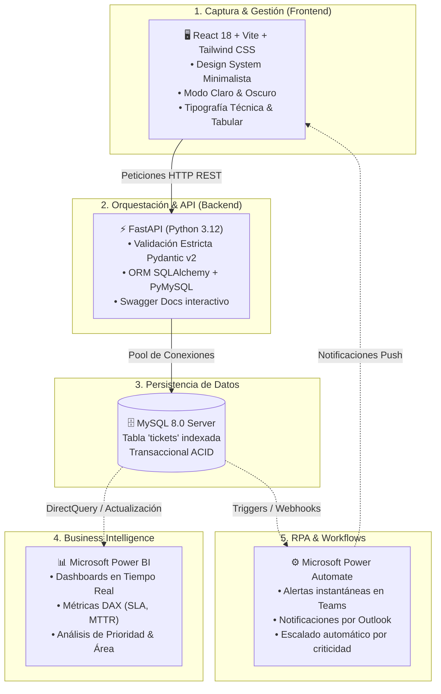

# 🛡️ Enterprise Incident Desk & Operational Intelligence Platform

> **Plataforma Integral de Gestión de Incidentes, Analítica Predictiva y Automatización de Procesos de Negocio.**  
> Diseñada para cerrar la brecha entre la **captura operativa de tickets**, la **orquestación de servicios REST**, la **inteligencia de datos ejecutiva (Power BI)** y la **automatización de flujos de trabajo (Power Automate)**.

---

## 🌟 Visión General del Ecosistema

Este proyecto trasciende un simple CRUD convencional: representa una **solución empresarial de punta a punta** que articula tecnologías modernas de desarrollo web, ingeniería de datos y el ecosistema de automatización corporativa:



---

## 🚀 Capacidades y Valor de Negocio

### 1. 🖥️ Frontend Minimalista de Alto Rendimiento (React + Vite)
- **Design System Editorial:** Inspirado en los estándares de interfaces de ingeniería moderna (*Linear*, *Vercel*, *Stripe*).
- **Tipografía de Grado Técnico:** Combinación de **Plus Jakarta Sans** (legibilidad geométrica) y **JetBrains Mono** con cifras tabulares (`tabular-nums`) para evitar desajustes visuales en métricas y tablas dinámicas.
- **Modo Claro / Modo Oscuro Nativo:** Selector táctil con persistencia en `localStorage` y detección automática de preferencias del sistema operativo.
- **UX Libre de Saturación:** Reemplazo de formularios invasivos por **modales accesibles** (`TicketModal`) y panel de inspección contextual (`TicketDetailModal`).
- **Segmented Controls & Búsqueda Instantánea:** Filtrado en memoria por estado, área departamental y nivel de prioridad sin latencia de red.

### 2. ⚡ Backend Robusto & Escalable (Python + FastAPI)
- **Contratos de Datos Rigurosos:** Validación y serialización con **Pydantic v2** mediante Enums tipados para Áreas (`TI`, `Operaciones`, `Ventas`, `Finanzas`, `RRHH`), Prioridades (`Baja`, `Media`, `Alta`, `Critica`) y Estados.
- **Capa ORM con Resiliencia:** SQLAlchemy configurado con verificación activa de socket (`pool_pre_ping=True`), reciclaje de conexiones (`pool_recycle=3600`) y codificación segura de credenciales vía `quote_plus`.
- **CORS Granular:** Seguridad perimetral lista para entornos locales y despliegues en nube.

### 3. 📊 Capa de Business Intelligence (Microsoft Power BI)
- **Conexión Directa:** Conecta Power BI Desktop directamente al servidor MySQL local o en nube.
- **Modelado Dimensional & KPIs Estratégicos:**
  - **MTTR (*Mean Time To Resolve*):** Tiempo promedio de resolución por área.
  - **Distribución de Criticidad:** Identificación visual de cuellos de botella en operaciones e infraestructura.
  - **Cumplimiento de SLA:** Alertas visuales sobre incidentes en estado *Abierto* con más de 48 horas sin atención.
- **Actualización Dinámica:** Comprobado mediante inyección concurrente vía API donde los gráficos de barras y tarjetas de valor suben de forma instantánea al presionar **`Actualizar`**.

### 4. ⚙️ Automatización de Procesos (Power Automate / RPA)
- **Alertas Proactivas:** Conexión con conectores estándar de base de datos o Webhooks HTTP para disparar un flujo automatizado ante incidentes catalogados como **Críticos**.
- **Notificaciones Multicanal:** Disparo automático de tarjetas adaptativas a canales dedicados en **Microsoft Teams** y correos ejecutivos mediante **Outlook 365**.
- **Matriz de Escalamiento:** Si un ticket permanece *En Proceso* durante más de $X$ horas, Power Automate eleva automáticamente la prioridad y notifica al líder del área.

### 5. 🐍 Scripting & Data Engineering con Python
- Incluye scripts de **inyección de datos masivos y simulación probabilística** (`seed.py` y `post_50_tickets.py`) que permiten poblar la base de datos con escenarios de incidentes corporativos realistas distribuidos en tiempo, áreas y criticidad.

---

## 📁 Estructura del Repositorio

```text
gestor py/
├── backend/
│   ├── .env.example          # Plantilla de variables de entorno seguras
│   ├── requirements.txt      # Dependencias oficiales de Python
│   ├── database.py           # Conexión SQLAlchemy con pool pre-ping y codificación segura
│   ├── models.py             # Modelo relacional de la tabla 'tickets'
│   ├── schemas.py            # Esquemas Pydantic y Enums estrictos
│   ├── main.py               # API RESTful, OpenAPI Swagger y middleware CORS
│   ├── seed.py               # Generador masivo de 100 incidentes sintéticos
│   └── post_50_tickets.py    # Script de prueba de integración vía HTTP POST directo
├── frontend/
│   ├── package.json          # Dependencias (React 18, Vite, Lucide Icons, Axios, Tailwind)
│   ├── vite.config.js        # Configuración de compilación ultrarrápida
│   ├── tailwind.config.js    # Design Tokens, tipografías y Dark Mode por clase
│   ├── index.html            # Carga de tipografías Plus Jakarta Sans & JetBrains Mono
│   └── src/
│       ├── api/
│       │   └── ticketService.js      # Cliente Axios modular con timeout de seguridad
│       ├── components/
│       │   ├── TicketModal.jsx       # Diálogo modal para creación de incidentes
│       │   ├── TicketDetailModal.jsx # Panel inspector de detalle y cambio de estado
│       │   └── TicketTable.jsx       # Data Grid con tabs segmentados, filtros y paginación
│       ├── App.jsx                   # Shell principal, switch Dark/Light y métricas KPI
│       ├── main.jsx
│       └── index.css                 # Directivas Tailwind y estilos de cifras tabulares
└── README.md
```

---

## 🛠️ Guía Rápida de Instalación y Despliegue

### Requisito 1: Base de Datos MySQL
En tu motor MySQL (MySQL Server, Workbench, HeidiSQL o phpMyAdmin):

```sql
CREATE DATABASE IF NOT EXISTS tickets_db 
CHARACTER SET utf8mb4 
COLLATE utf8mb4_unicode_ci;
```

---

### Requisito 2: Backend (FastAPI)

1. Ingresa al directorio `backend`:
   ```bash
   cd backend
   ```

2. Activa tu entorno virtual de Python:
   ```bash
   # Windows PowerShell:
   .\venv\Scripts\activate
   ```

3. Instala dependencias:
   ```bash
   pip install -r requirements.txt
   ```

4. Define tus credenciales en el archivo `.env`:
   ```ini
   DB_USER=root
   DB_PASSWORD=tu_contraseña
   DB_HOST=localhost
   DB_PORT=3306
   DB_NAME=tickets_db
   CORS_ORIGIN=http://localhost:5173
   ```

5. Inicia el servidor de desarrollo:
   ```bash
   uvicorn main:app --reload --port 8000
   ```
   - **API Base:** `http://localhost:8000`
   - **Swagger Interactivo:** `http://localhost:8000/docs`

---

### Requisito 3: Frontend (React + Vite)

1. En una nueva terminal, ingresa a la carpeta `frontend`:
   ```bash
   cd frontend
   ```

2. Instala los paquetes de Node.js:
   ```bash
   npm install
   ```

3. Inicia la aplicación:
   ```bash
   npm run dev
   ```
   - Abre en tu navegador: **`http://localhost:5173`**

---

### Requisito 4: Conectar Power BI

1. Abre **Power BI Desktop**.
2. Selecciona **Obtener datos** -> **Base de datos MySQL**.
3. Servidor: `localhost:3306` | Base de datos: `tickets_db`.
4. Selecciona la tabla `tickets` y carga los datos.
5. Diseña tus visualizaciones (Tarjetas KPI, Gráficos de barras apiladas por Área y Prioridad).
6. Al registrar nuevos tickets en la web, haz clic en **Actualizar** en Power BI para ver la sincronización inmediata.

---

### Requisito 5: Inyección Masiva de Prueba (Testing de Carga)
Para simular un entorno corporativo con tráfico real y probar dashboards en Power BI:

```bash
# Inyectar 100 incidentes variados directamente en la base de datos:
python seed.py

# O enviar 50 tickets secuenciales vía peticiones HTTP POST reales a la API:
python post_50_tickets.py
```

---

## 📋 Entidad de Datos (`Ticket`)

| Campo | Tipo | Restricciones / Reglas de Negocio |
|---|---|---|
| `id` | `INT` | Clave primaria, autoincremental, indexado. |
| `titulo` | `VARCHAR(100)` | Obligatorio, longitud máxima 100 caracteres. |
| `descripcion` | `TEXT` | Obligatorio, detalle narrativo del incidente. |
| `area` | `VARCHAR(50)` | `TI`, `Operaciones`, `Ventas`, `Finanzas`, `Recursos Humanos`. |
| `prioridad` | `VARCHAR(20)` | `Baja`, `Media`, `Alta`, `Critica`. |
| `estado` | `VARCHAR(20)` | `Abierto`, `En Proceso`, `Resuelto` (Default: `Abierto`). |
| `fecha_creacion` | `DATETIME` | UTC Timestamp automático al momento del registro. |

---

## 🎯 Caso de Uso Demostrativo (Storytelling para Presentaciones)

> *"Este sistema demuestra cómo una empresa reduce tiempos de respuesta en incidentes críticos conectando un frontend ágil y minimalista con una API Python de alta velocidad, centralizando el estado en MySQL, proveyendo visibilidad estratégica instantánea a la gerencia mediante **Power BI**, y habilitando canales de notificación desatendidos con **Power Automate**."*
